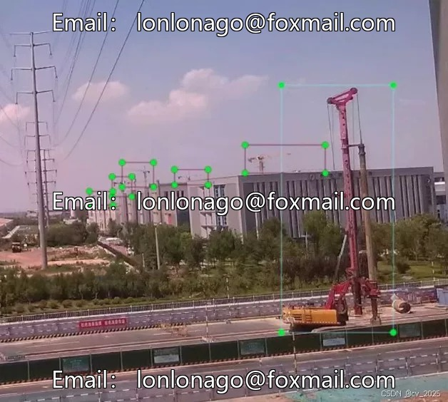
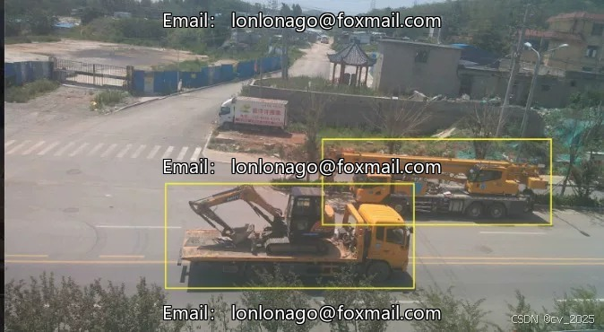
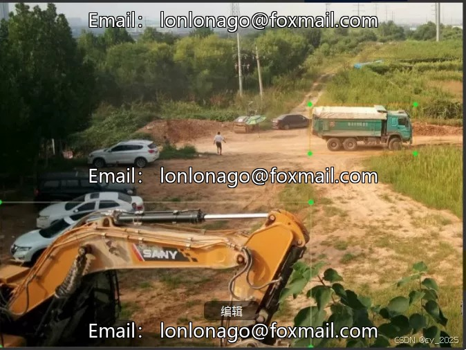
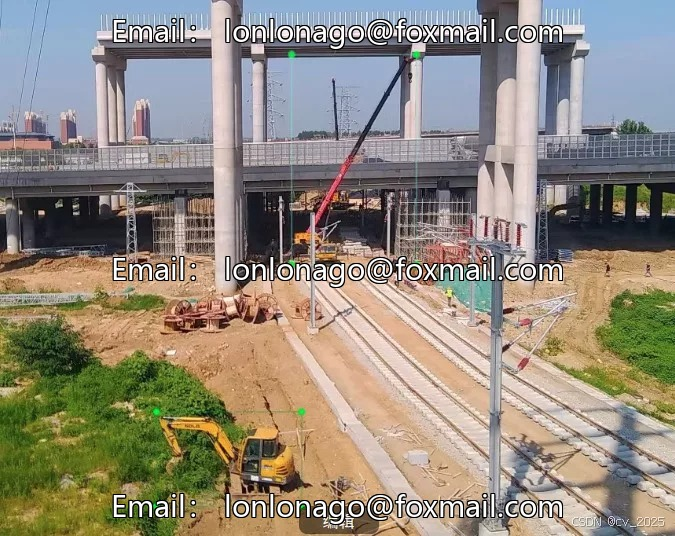

# Construction site engineering vehicle equipment dataset

## Body

Construction Site Equipment Data Set for Trucks
Graduate Design Second-hand Data Sale
Drone photography, captured from a high-altitude perspective, labeled in YOLO style. The dataset
Contains over 6700 entries
9 major categories, covering excavators, tower cranes, dump trucks, and more
Ideal for research and applications related to construction equipment.

Interested friends can contact me for support after viewing the car. Click "I want" to proceed.

Virtual materials, once sold, are non-refundable.

## Images

## Payment

Here is a pay link on Stripe ( https://buy.stripe.com/3cs8yP7sY87d0vu9AB ). Please contact me lonlonago@foxmail.com after funding $89, and I will send you a complete data files , thank you!

